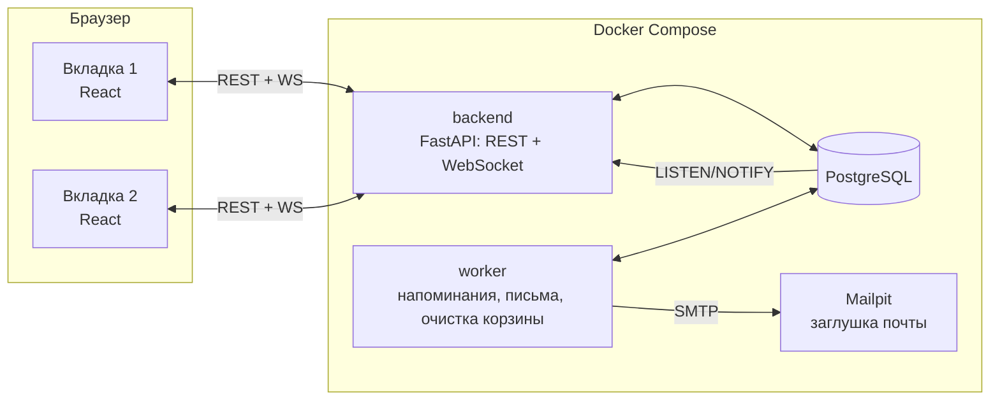

# Архитектура Notetaker

Личные заметки, привязанные к дате и времени: календарь, теги, повторы, напоминания письмом и всплывающим уведомлением во всех открытых вкладках.

## 1. Компоненты



| Сервис | Что делает | Порт на хосте |
|---|---|---|
| `frontend` | React + Vite, интерфейс | 5173 |
| `backend` | FastAPI: REST API, WebSocket `/api/ws`, вход | 8000 (документация API: `/docs`) |
| `worker` | тот же код, отдельный процесс: отправляет напоминания, письма, очищает корзину | — |
| `db` | PostgreSQL 17, данные в docker volume | 5433 (5432/5434 заняты другими проектами) |
| `mailpit` | ловит все письма, веб-интерфейс для просмотра | 8025 (SMTP 1025) |

**Почему worker — отдельный процесс.** Напоминания не должны зависеть от того, сколько копий API запущено и перезапускался ли API. Worker берёт задания из базы через `FOR UPDATE SKIP LOCKED`, поэтому даже два worker'а одновременно не отправят одно напоминание дважды.

**Как события доходят до вкладок.** Любое изменение (API или worker) делает в той же транзакции `NOTIFY user_<id>`. API слушает `LISTEN` и рассылает событие по WebSocket всем вкладкам этого пользователя. Без Redis: меньше сервисов, Postgres уже есть.

## 2. Стек и почему

| Слой | Выбор | Почему |
|---|---|---|
| Backend | Python 3.12, FastAPI, Uvicorn | Знакомый язык, асинхронность нужна для WebSocket, автодокументация API |
| ORM/миграции | SQLAlchemy 2 (async) + asyncpg, Alembic | Стандарт, миграции воспроизводимы |
| Пароли | argon2-cffi | Современный безопасный хеш |
| Повторы | своя функция развёртки + `zoneinfo` | Правил всего три (день/неделя/месяц), нужен контроль над «31-м числом» и часовыми поясами; `dateutil.rrule` для месячных пропускает короткие месяцы |
| Почта | aiosmtplib → Mailpit | Заглушка по SMTP: код такой же, как для настоящей почты |
| Frontend | React 18 + TypeScript + Vite | Требование задания (Vue или React) |
| UI-компоненты | Mantine 7 | Готовые выбор даты и времени, выбор цвета, мультиселект тегов, всплывающие уведомления — экономит день |
| Календарь | FullCalendar 6 (daygrid, timegrid, interaction, luxon) | Месяц/неделя/день и перетаскивание из коробки; плагин luxon показывает время в часовом поясе пользователя |
| Данные на клиенте | TanStack Query | Кэш + `invalidate` по событию из WebSocket = календарь, список и «Ближайшее» обновляются сами |
| Длинный список | TanStack Virtual + курсорная пагинация | Тысячи заметок без тормозов |
| Тесты | pytest + httpx (backend), Playwright (две вкладки в браузере) | Доказуемость |

## 3. Модель данных

```
users          id, email (уникальный, он же адрес для писем), password_hash, timezone ('Asia/Bishkek'), created_at
sessions       id (случайный токен), user_id, expires_at              — вход: httpOnly cookie
tags           id, user_id, name, color ('#RRGGBB')                    — уникальность (user_id, lower(name))
notes          id (uuid), user_id, title, body,
               start_at timestamptz        — момент заметки (UTC)
               tz text                     — пояс серии (для повторов «в 9:00 по местному»)
               is_active bool
               freq: none|daily|weekly|monthly, until date NULL   — повтор и дата окончания
               reminders int[]             — смещения в минутах: {10, 60, 1440}
               version int                 — для обнаружения конфликтов правки
               created_at, updated_at, deleted_at NULL (корзина)
               split_from uuid NULL        — серия, от которой отделили «начиная с этого дня»
note_tags      note_id, tag_id                                         — многие-ко-многим
occurrence_overrides
               note_id, original_start     — какое вхождение серии (ключ)
               cancelled bool              — вхождение удалено
               title, body, start_at, is_active  — NULL = как в серии
               version, updated_at
reminder_jobs  id, user_id, note_id, occurrence_start, offset_min, fire_at,
               status: pending|sent|skipped
               UNIQUE (note_id, occurrence_start, offset_min, fire_at)
notifications  id, user_id, note_id, occurrence_start, text, fired_at, shown_at NULL
email_outbox   id, job_id UNIQUE, to_addr, subject, body, status: pending|sent|failed, attempts, sent_at
```

Индексы: `notes(user_id, start_at)`, `notes(user_id, updated_at)`, `notes(user_id, deleted_at)`, GIN `pg_trgm` по `title` и `body` (поиск подстроки, в том числе по-русски), `reminder_jobs(fire_at) WHERE status='pending'`.

**Вхождение** повторяющейся заметки определяется парой `(note_id, original_start)`. В API его id — `"<note_id>:<original_start ISO>"`.

## 4. Ключевые механизмы

### 4.1 Повторы и исключения
- Развёртка идёт в «настенном» времени пояса серии (`notes.tz`): «каждый день в 9:00» остаётся в 9:00 даже при переходе на летнее время.
- Ежемесячно 31-го: в коротком месяце — последний день месяца.
- `until` включительно: последнее вхождение — в этот день.
- **Изменить только это вхождение**: строка в `occurrence_overrides`. **Удалить только это**: та же строка с `cancelled=true`.
- **Изменить «начиная с этого дня»**: серия делится. У старой `until` = день перед выбранным вхождением, создаётся новая серия с изменениями. Прошлые вхождения остаются в старой серии и не меняются. Исключения после точки разреза удаляются (как в Google Calendar), это описано в интерфейсе.
- **Изменить всю серию**: правится сама заметка.
- Перетаскивание вхождения в календаре меняет только это вхождение (override). Для обычной заметки меняет её время.

### 4.2 Напоминания: ровно одно письмо на напоминание
1. **Планировщик** (`replan(note)`) вызывается в той же транзакции, что и любое изменение заметки: создание, правка времени или напоминаний, активация и деактивация, удаление и восстановление, правка вхождения. Он удаляет `pending`-задания заметки и, если заметка активна и не в корзине, создаёт задания на вхождения, у которых `fire_at > now()`, в горизонте 7 дней. `ON CONFLICT DO NOTHING`: уже отправленное повторно не создаётся.
2. **Продление горизонта**: worker раз в 10 минут дописывает задания повторяющимся заметкам на следующие 7 дней.
3. **Диспетчер** (worker, цикл ≤ 1 с): `SELECT … WHERE status='pending' AND fire_at <= now() FOR UPDATE SKIP LOCKED`. Для каждого задания ещё раз проверяет, что заметка активна и не удалена. Затем в одной транзакции: статус `sent`, строка в `email_outbox`, строка в `notifications`, `NOTIFY` во вкладки.
4. **Отправщик писем**: берёт `email_outbox` (тоже `SKIP LOCKED`), шлёт через SMTP, ставит `sent`. В письме заголовок `Message-ID` = id задания, так что почтовые программы склеят дубль, если процесс упадёт ровно между отправкой и записью статуса. Это честно описано как остаточный риск.

Как это закрывает требования:

| Требование | Почему выполняется |
|---|---|
| Деактивированная не напоминает | `replan` удаляет pending; диспетчер перепроверяет активность |
| Активировали до срока — вернулись; после — не досылаются | `replan` создаёт только `fire_at > now()` |
| Изменение времени или интервала переносит | `replan` при каждой правке |
| Удаление отменяет, восстановление возвращает будущие | то же |
| Повтор напоминает о каждом вхождении | задания на каждое вхождение + продление горизонта |
| Смена пояса не меняет момент срабатывания | `start_at` и `fire_at` в UTC, пояс пользователя только для отображения |
| Ровно одно | уникальный ключ задания + `SKIP LOCKED` + outbox с `job_id UNIQUE` |

**Простой сервера (решение).** При старте worker находит `pending`-задания с прошедшим `fire_at`:
- событие (время заметки) ещё не наступило → напоминание отправляется сразу с пометкой «с опозданием»;
- событие уже прошло → статус `skipped`, письмо не шлётся (оно бесполезно), во вкладке появляется одно сводное уведомление «пропущено напоминаний за время простоя: N».

### 4.3 Всплывающие уведомления во всех вкладках
- В момент срабатывания диспетчер пишет строку в `notifications`, и событие `notification.fired` приходит по WebSocket во все открытые вкладки одновременно.
- Вкладка показывает уведомление и шлёт `POST /api/notifications/{id}/shown` (повторный вызов ничего не меняет). После обновления страницы `shown_at` уже заполнен, и уведомление не всплывает снова.
- Если в момент срабатывания не было открытых вкладок, при следующем открытии показываются непоказанные уведомления за последние 24 часа. Один раз.

### 4.4 Синхронизация вкладок и конфликты правок
- События по WebSocket: `note.changed`, `note.deleted`, `tag.changed`, `settings.changed`, `notification.fired`. Клиент делает `invalidateQueries`, и календарь, список, «Ближайшее» и открытая заметка перезапрашиваются.
- После переподключения WebSocket клиент перезапрашивает всё, иначе пропущенные события потеряются.
- **Конфликт.** Каждая правка отправляет `version`. Если она устарела, сервер отвечает `409` и присылает текущую версию. Открытый редактор с несохранёнными правками, получив событие о новой версии, сразу показывает баннер «Заметку изменили в другой вкладке» с вариантами: «показать их версию», «сохранить мою поверх», «скопировать мой текст». Молча ничего не теряется.

### 4.5 Часовые пояса
- Хранение — UTC (`timestamptz`). Отображение — в поясе из настроек: FullCalendar с `timeZone`, форматирование через Luxon.
- Пояс серии (`notes.tz`) берётся из настроек в момент создания. Он нужен только для того, чтобы повтор был «в 9:00 по местному». Смена пояса в настройках не трогает существующие серии и момент напоминаний.

### 4.6 «Ближайшее»
- Сегодня: вхождения с `now` до конца дня по поясу пользователя. На неделе: следующие 7 дней. Прошедшие активные: активные вхождения с временем раньше `now` за последние 7 дней, с кнопкой «сделать неактивной».
- Переход в «прошедшие» без обновления: клиент ставит таймер на ближайшее время начала и пересортировывает. Плюс перезапрос раз в минуту на случай сна ноутбука.

### 4.7 Список, поиск, тысячи заметок
- Поиск и фильтры только на сервере, по всем заметкам: подстрока в title/body (`ILIKE` + индекс `pg_trgm`), теги, статус, период, корзина исключена.
- Сортировка: по дате заметки или по дате изменения. Курсорная пагинация `(sort_value, id)`, страницы по 50.
- На клиенте бесконечная прокрутка + виртуализация (в DOM только видимые строки).
- Повторяющаяся заметка в списке — одна строка с отметкой повтора. В период попадает, если серия пересекает период.
- Проверка: `seed` на 5000 заметок, тест, что запрос списка укладывается в 100 мс.

### 4.8 Корзина
- Удаление: `deleted_at = now()`, pending-задания удаляются.
- Восстановление: `deleted_at = NULL`, `replan`.
- Worker раз в час удаляет насовсем заметки с `deleted_at < now() - 30 дней`.

### 4.9 Вход
Почта + пароль (argon2). Сессия — случайный токен в httpOnly cookie, таблица `sessions`. Тот же cookie авторизует WebSocket. Демо-аккаунт создаётся автоматически: `demo@example.com` / `demo12345`.

## 5. API (черновик)

```
POST   /api/auth/register | /api/auth/login | /api/auth/logout      GET /api/me
GET    /api/settings       PATCH /api/settings                       — почта, часовой пояс
GET    /api/tags           POST /api/tags   PATCH|DELETE /api/tags/{id}
GET    /api/notes?q=&tags=&status=&from=&to=&sort=start|updated&cursor=&limit=
POST   /api/notes          GET|PATCH|DELETE /api/notes/{id}          — PATCH c version; DELETE = в корзину
GET    /api/occurrences?from=&to=                                     — для календаря и «Ближайшего»
PATCH  /api/notes/{id}/occurrences/{start}?scope=this|following       — правка вхождения
DELETE /api/notes/{id}/occurrences/{start}?scope=this|following
GET    /api/upcoming
GET    /api/trash          POST /api/trash/{id}/restore   DELETE /api/trash/{id}
GET    /api/notifications?unshown=1    POST /api/notifications/{id}/shown
WS     /api/ws
```

## 6. Структура репозитория

```
notetaker/
├── docker-compose.yml          db, mailpit, backend, worker, frontend
├── Makefile                    up, down, test, e2e, seed, demo
├── .env.example
├── README.md                   запуск, состояние, что дальше
├── docs/
│   ├── ARCHITECTURE.md         этот файл
│   ├── PLAN.md                 план по дням
│   ├── REQUIREMENTS.md         каждое требование → как сделано → чем доказано
│   ├── DECISIONS.md            лог решений с датами
│   └── WORKLOG.md              журнал работы с метками времени
├── backend/
│   ├── Dockerfile  pyproject.toml  alembic.ini
│   ├── migrations/
│   ├── app/
│   │   ├── main.py  config.py  db.py  models.py  schemas.py  clock.py (подменяемое «сейчас» для тестов)
│   │   ├── api/        auth.py settings.py tags.py notes.py occurrences.py upcoming.py trash.py notifications.py ws.py
│   │   ├── services/   recurrence.py planner.py notes.py realtime.py mail.py
│   │   └── worker/     __main__.py dispatcher.py mailer.py janitor.py
│   ├── scripts/        seed.py (5000 заметок)  demo_reminder.py
│   └── tests/
├── frontend/
│   ├── Dockerfile  package.json  vite.config.ts
│   └── src/
│       ├── api/        client.ts, хуки TanStack Query
│       ├── realtime/   ws.ts (переподключение, invalidate)
│       ├── pages/      Login Calendar Notes Upcoming Trash Tags Settings
│       ├── components/ NoteEditor ConflictBanner ScopeDialog TagPicker ReminderPicker RecurrencePicker NotificationCenter
│       └── lib/        time.ts (Luxon, пояс пользователя)
└── e2e/                Playwright: сценарии с двумя вкладками
```
